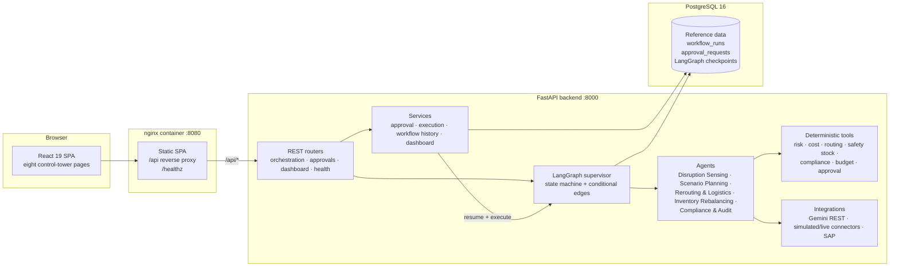

# X FACTOR — Architecture

X FACTOR is one coordinated agentic system: **Detect → Reason → Simulate →
Approve → Execute**. It is not a collection of independent chatbots. A LangGraph
supervisor decides what runs next from the recorded state, five specialised
agents do the work, deterministic Python functions own every number, and no
high-impact action executes without an authenticated human decision.

---

## 1. Runtime topology

The Compose stack runs these as four services — `db`, a one-shot `seed`,
`backend` and `frontend`. The Vite dev server is used only for local
development; the container build serves the compiled SPA through nginx and
proxies `/api` to the backend, so the browser never needs CORS or a hard-coded
backend host.

---

## 2. Component responsibilities

| Layer | Component | Responsibility |
| --- | --- | --- |
| HTTP | `app/api/orchestration.py` | Start a run, read a saved checkpoint. Never resumes an approval anonymously. |
| HTTP | `app/api/approvals.py` | Authenticated pending queue, one proposal, decision, execution report. |
| HTTP | `app/api/dashboard.py` | Read-only projection: overview, runs, disruptions, shipments, inventory. |
| HTTP | `app/api/health.py` | `/api/health` (database-aware) and `/api/health/live` (dependency-free). |
| Orchestration | `app/orchestration/workflow.py` | Supervisor routing, agent nodes, bounded replanning, approval interrupt, finalise. |
| Orchestration | `app/orchestration/approvals.py` | Proposal snapshot and SHA-256 proposal version. |
| Orchestration | `app/orchestration/checkpointing.py` | In-memory or PostgreSQL LangGraph checkpointer. |
| Agents | `app/agents/*.py` | Pydantic-validated agent I/O; the model explains, it never decides. |
| Tools | `app/tools/*.py` | Deterministic scoring, costing, routing, inventory and compliance rules. |
| Services | `app/services/*.py` | Approval authorisation and history, idempotent execution, run history, dashboard reads. |
| Integrations | `app/integrations/*.py` | Gemini client, external data connectors (simulated by default), SAP read/write boundary. |
| Frontend | `frontend/src/pages/*.jsx` | Eight pages wired to real endpoints with loading/error/empty states. |

---

## 3. Request lifecycle

1. `POST /api/orchestration/workflows` receives a `RecoveryRequest` (disruption
   report + lane + optional inventory analysis).
2. The supervisor selects the next node and records a `SupervisorDecision`.
3. **Disruption Sensing** extracts a structured, risk-scored assessment.
4. The supervisor decides whether a full recovery plan is needed. For the demo
   scenario it delegates **Scenario Planning**, which composes **Rerouting &
   Logistics** and **Inventory Rebalancing** so the route and the stock transfer
   are evaluated against the same numbers.
5. **Compliance & Audit** validates the recommendation against deterministic
   rules (sanctions, budget, inventory, documentation, high-impact policy).
6. The graph persists a checkpoint, builds a proposal snapshot with a SHA-256
   version and **interrupts** at the approval gate.
7. An authenticated approver (`APPROVER_CREDENTIALS`) approves, rejects or
   requests modifications through `/api/approvals/{thread}/decision`. The
   version the reviewer saw must match.
8. Approval resumes the graph from PostgreSQL and the **ExecutionService** runs
   the plan exactly once per `thread:proposal_version:action_type`. The default
   adapter is clearly labelled `[SIMULATED]`.
9. The run is projected into `workflow_runs`; the dashboard reads that
   projection and the recorded state.

A rejected proposal produces no execution report. A duplicate decision returns
`409` and does not execute again.

---

## 4. Deterministic vs. LLM boundary

- Gemini reads unstructured text and writes narrative explanations only.
- Pydantic schemas cannot carry a different verdict, score, cost or quantity
  than the deterministic result; tests assert the model cannot override it.
- Distances, transit days, costs, safety stock, risk scores, feasibility,
  compliance verdicts, approval level and proposal versions are computed in
  Python.
- If Gemini is unavailable, agents fail honestly with a recorded error; they
  never fabricate an assessment.

---

## 5. Persistence

| Store | Contents | Purpose |
| --- | --- | --- |
| `suppliers`, `shipments` | Seeded demo master data | Lane and supplier validation; clearly labelled demo rows |
| `workflow_runs` | One row per thread: status, summary, full JSON-safe state | Dashboard projection and audit history |
| `approval_requests` | One JSON row per thread: proposal, history, execution | Approval queue recovery after a restart |
| `checkpoints`, `checkpoint_blobs`, `checkpoint_writes`, `checkpoint_migrations` | LangGraph state and pending interrupts | Resume a paused workflow in a different process |

Every table is created idempotently at startup or on first use. The Compose
deployment puts PostgreSQL on a named volume, so runs, decisions and checkpoints
survive `docker compose down` / `up`.

---

## 6. Diagrams

- [LangGraph workflow diagram](langgraph-workflow.mmd) — generated from the
  compiled graph.
- [Workflow reference](workflow.md)
- [Collaboration and replanning](collaboration.md)
- [Approval and execution](approval-and-execution.md)
- [SAP integration](sap-integration.md)
- [Dashboard](dashboard.md)
- [Validation report](validation-report.md)
