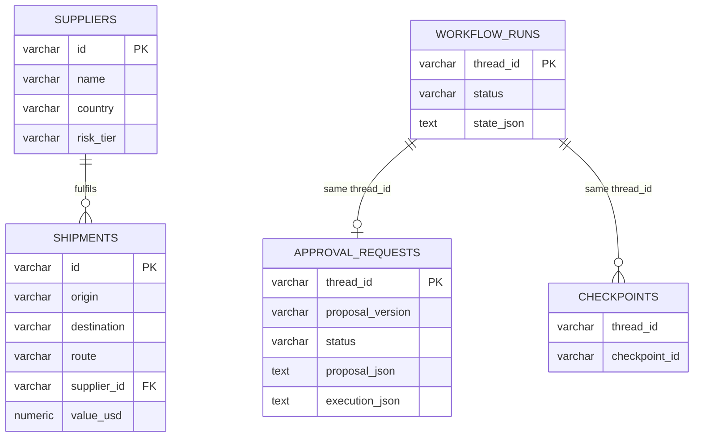

# X FACTOR — Database Schema

PostgreSQL is used for two purposes: **application data** (reference master
data, the workflow-run projection and the approval queue) and **LangGraph
checkpoint persistence** (so a paused workflow can resume in another process).
Both use the same connection configured by `DATABASE_URL` or the discrete
`POSTGRES_*` variables.

All tables are created idempotently: `ensure_reference_schema()` (seed),
`ensure_approval_schema()` and `ensure_workflow_run_schema()` at application
startup, and `PostgresSaver.setup()` when the checkpointer opens.

---

## 1. Application tables

### `suppliers`

Seeded demo master data (`app/models/supply_chain.py`).

| Column | Type | Notes |
| --- | --- | --- |
| `id` | `varchar(16)` PK | e.g. `SUP001` |
| `name` | `varchar(120)` | Aurora Pharma Ingredients |
| `country` | `varchar(80)` | India |
| `category` | `varchar(80)` | Pharmaceutical |
| `risk_tier` | `varchar(16)` | Low / Medium / High |

### `shipments`

Seeded demo master data; the demo lane is `SH001` (Mumbai → Rotterdam via Suez,
Red Sea, Bab-el-Mandeb).

| Column | Type | Notes |
| --- | --- | --- |
| `id` | `varchar(16)` PK | e.g. `SH001` |
| `origin`, `destination` | `varchar(120)` | Indexed |
| `route` | `varchar(240)` | Human-readable lane used for disruption matching |
| `transport_mode` | `varchar(32)` | Sea / Air / Rail / Road |
| `carrier` | `varchar(80)` | Seeded carrier |
| `status` | `varchar(32)` | In Transit, Delayed, Delivered |
| `cargo` | `varchar(120)` | Pharmaceutical API |
| `value_usd` | `numeric(14,2)` | Declared cargo value |
| `supplier_id` | `varchar(16)` FK → `suppliers.id` | Indexed |

### `workflow_runs`

One row per LangGraph thread; a projection of recorded state, not a second
source of truth (`app/models/workflow_runs.py`).

| Column | Type | Notes |
| --- | --- | --- |
| `thread_id` | `varchar(120)` PK | Event id or caller-supplied thread |
| `event_id` | `varchar(120)` | Indexed |
| `disruption_type`, `severity`, `location` | `varchar` | Summary columns |
| `origin`, `destination` | `varchar(120)` | Lane |
| `status` | `varchar(48)` | Indexed; pending/completed/failed/… |
| `awaiting_approval` | `boolean` | Paused at the human gate |
| `risk_score` | `integer` | From the deterministic assessment |
| `recommended_scenario_id` | `varchar(80)` | When a plan was built |
| `headline`, `summary` | `text` | Human summary |
| `execution_count` | `integer` | Labelled execution actions |
| `error_count` | `integer` | Recorded errors |
| `state_json` | `text` | Full JSON-safe workflow state (interrupt objects stripped) |
| `created_at`, `updated_at` | `timestamptz` | UTC |

### `approval_requests`

One row per thread; updated in place across modification rounds
(`app/models/approvals.py`).

| Column | Type | Notes |
| --- | --- | --- |
| `thread_id` | `varchar(120)` PK | One approval object per workflow |
| `event_id` | `varchar(120)` | Indexed |
| `proposal_id` | `varchar(160)` | Deterministic proposal identity |
| `proposal_version` | `varchar(64)` | SHA-256; stale versions are rejected |
| `approval_level` | `varchar(32)` | Manager / Director / Admin |
| `status` | `varchar(32)` | Indexed; pending / approved / rejected / modifications_requested |
| `proposal_json` | `text` | Full `ProposalSnapshot` |
| `decision_history_json` | `text` | One entry per authenticated decision |
| `execution_json` | `text` | Execution report after approval |
| `created_at`, `updated_at` | `timestamptz` | UTC |

---

## 2. LangGraph checkpoint tables

Created by `langgraph-checkpoint-postgres` (`PostgresSaver.setup()`):

| Table | Purpose |
| --- | --- |
| `checkpoints` | One row per checkpoint: thread, checkpoint id, parent, metadata |
| `checkpoint_blobs` | Channel values (the serialised graph state) |
| `checkpoint_writes` | Pending writes from each node within a super-step |
| `checkpoint_migrations` | Applied adapter migrations |

These tables are what allow an approval to resume a workflow created by a
previous process. In the Compose stack they live on the `postgres-data` named
volume.

---

## 3. Relationships and lifecycle



The IDs are related logically, not by foreign keys, because checkpoint tables are
owned by the LangGraph adapter and a thread can exist there before a projection
row is written.

---

## 4. Operations

```powershell
# Seed or refresh the demo master data (idempotent).
cd backend
..\.venv\Scripts\python.exe -m scripts.seed_reference_data

# Inspect run history.
psql "$env:DATABASE_URL" -c "select thread_id, status, execution_count from workflow_runs order by updated_at desc;"

# Inspect the approval queue.
psql "$env:DATABASE_URL" -c "select thread_id, status, proposal_version, approval_level from approval_requests;"
```

Inside Compose, use `docker compose exec db psql -U xfactor -d xfactor`.
