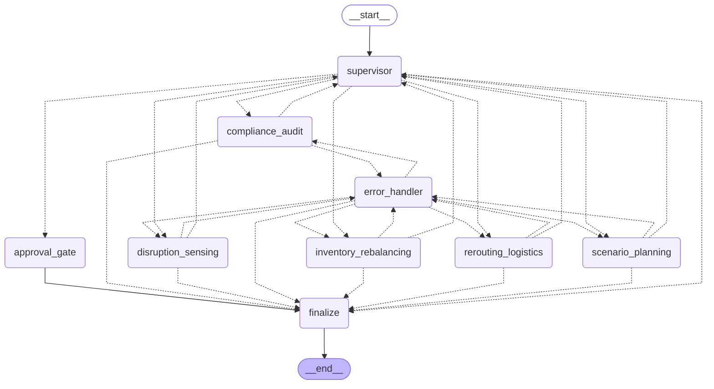
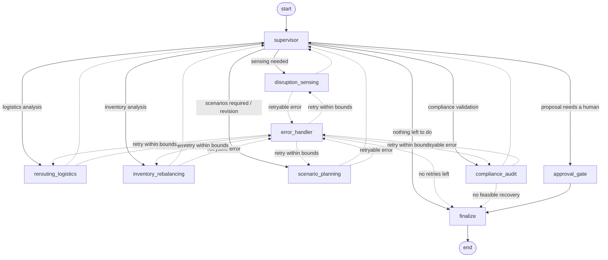

# X FACTOR Supervisor Workflow (Step 4)

The orchestration layer is a single compiled [LangGraph](https://langchain-ai.github.io/langgraph/)
graph, built by `app.orchestration.workflow.build_graph`. One supervisor node
delegates to five agent nodes through conditional edges, guarded by an
error-handling node, a human approval gate and a terminal `finalize` node.

This document is the required graph visualisation for Step 4. The Mermaid source
below is emitted verbatim by `mermaid_diagram(graph)` from the compiled graph, so
it always matches the code.

## Graph as compiled

The dotted edges are the conditional routes. LangGraph draws every route the
conditional function *may* return, so the fan-out is wide; at run time exactly one
edge is taken per pass.

## Readable view of the same graph

## Nodes

| Node | Kind | Responsibility |
| --- | --- | --- |
| `supervisor` | control | Chooses the next node from validated structured results and records a `SupervisorDecision(step, action, reason)` for every pass. |
| `disruption_sensing` | agent | Assesses the disruption report; deterministic scoring fills `risk_score`/`severity` and links master-data shipments. |
| `rerouting_logistics` | agent | Ranks candidate routes for one lane. |
| `inventory_rebalancing` | agent | Balances one material across plants without breaching safety stock. |
| `scenario_planning` | agent | Ranks recovery scenarios; composes the rerouting and inventory agents internally. |
| `compliance_audit` | agent | Validates compliance, budget and approval; derives the verdict deterministically. |
| `approval_gate` | interrupt | Pauses the graph for a human decision when the audit requires sign-off. |
| `error_handler` | control | Records a failed agent run and decides whether one bounded retry is allowed. |
| `finalize` | terminal | Collapses the run into a frozen `RecoveryRecommendation`. |

## The supervisor's dynamic decisions

The supervisor **never runs a fixed sequence**. On each pass it reads the current
state and returns exactly one of:

1. **Logistics analysis is required** — no route has been ranked for the lane yet.
2. **Inventory analysis is required** — the caller supplied a `ScenarioRequest.inventory`.
3. **Additional scenarios are required** — the disruption is High/Critical severity or
   affects more than one shipment.
4. **A scenario needs revision** — a recommended scenario was assessed as infeasible
   and the single allowed revision round has not been used.
5. **Compliance validation is required** — a recommended route/scenario exists but has
   not been audited.
6. **The workflow can proceed to approval** — a compliant, affordable recommendation
   exists; it is routed either to `approval_gate` (when a human must sign off) or
   straight to `finalize`.

Every decision states its reason in the `decisions` log, so the run is auditable
without a conversation transcript.

## Bounds, retries and error handling

* **Iteration bound** — the supervisor stops after `LANGGRAPH_MAX_ITERATIONS × 5`
  passes and finalises with status `iteration_limit_reached`.
* **Retries** — each agent may be attempted `_MAX_AGENT_ATTEMPTS` (2) times. A
  failure that is *not* a hard configuration/validation error is routed through
  `error_handler`, which allows one retry.
* **Non-retryable failures** — `GeminiNotConfiguredError`,
  `IntegrationNotConfiguredError`, `ToolInputError` and base `ValidationError` fail
  the run immediately instead of burning retries.
* **Earlier work is preserved** — a later failure never discards the assessment or
  scenario plan already stored in the state.

## Interruption and resume

`approval_gate` calls LangGraph's `interrupt(...)`, which pauses the graph and
returns the approval request to the caller. The run continues from its saved
checkpoint when the caller resumes with `{"approved": bool, "comment": str}`. An
approval is recorded as `STATUS_COMPLETED`; a rejection as `STATUS_APPROVAL_REJECTED`.

## Checkpointing

Two checkpointers are offered by `app.orchestration.checkpointing`:

* `in_memory_checkpointer()` — `InMemorySaver`, used by tests and single-process runs.
* `postgres_checkpointer()` — `PostgresSaver` writing every checkpoint to the
  application's PostgreSQL database, so a run paused in one process can be resumed
  in another. `checkpointer_dsn()` strips the `+psycopg2` suffix because the
  checkpointer adapter speaks psycopg 3 / libpq while the app's engine speaks psycopg2.

The backend is selected by `LANGGRAPH_CHECKPOINT_BACKEND` (`"postgres"` by default).

## HTTP surface

| Method | Path | Purpose |
| --- | --- | --- |
| `POST` | `/api/orchestration/workflows` | Start a run for one disruption. |
| `POST` | `/api/orchestration/workflows/{thread_id}/resume` | Answer the approval gate and continue. |
| `GET` | `/api/orchestration/workflows/{thread_id}/state` | Read the last saved state. |
